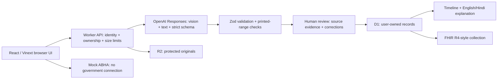

# Sehat Saathi — Personal Health Copilot

A college hackathon prototype for the Altrix Labs challenge. It turns reports into reviewable structured records, English/Hindi explanations and a unified timeline.

## What works

- PDF, PNG, JPG and TXT upload (5 MB maximum), plus pasted report text.
- Server-side OpenAI Responses vision/text extraction into a strict JSON schema; Zod runtime validation.
- Medicines, dosages, explicitly documented diagnoses, dates, results, units and source evidence.
- Human review with corrections and removal of incorrect findings. Missing or unreadable details stay unknown.
- Comparisons against unambiguous inclusive ranges printed in the report, never imported generic ranges.
- English/Hindi summaries and interface, retaining original medical names, measurements and source text.
- Signed-in user ownership, D1 persistence, R2 originals, duplicate detection, 20 analysis attempts per UTC day, record deletion.
- FHIR R4-style collection export and explicitly fictional mock ABHA link.
- A prepared synthetic sample that works without paid inference and is labelled as a prepared example.
- Architecture and three-minute demonstration guide inside **About this prototype**.

## Current external limitation

The live API smoke test reached OpenAI and returned `billing_not_active`. The configured key is valid enough to reach the billing check, but live inference cannot be verified until the project has active API billing. Activate billing in OpenAI Platform; no new key or code change should be needed unless the provider returns another account restriction. The app does not substitute the prepared sample for a failed live request.

## Architecture



### Data model

`records`: ID, owner, normalized extraction JSON, filename, R2 object key, MIME, content hash, review state, creation timestamp and analysis method. The extraction contains report date, source patient name, provider, observations, medicines, source-documented diagnoses, bilingual summaries and uncertainties.

`profiles`: per-user mock identity state. `usage`: atomic per-user daily analysis counter. The ownership/date and ownership/hash indexes support record listing and duplicate detection. Generated Drizzle migrations are under `drizzle/`.

FHIR export uses Patient, DocumentReference, Observation, DiagnosticReport and MedicationRequest/MedicationStatement. References resolve inside a `collection` Bundle. Patient names are not identity verification: each source document gets a separate Patient resource until explicit patient matching is implemented. Unknown clinical status remains unknown; user transcription review does not change clinical status. The mock identifier uses a fictional namespace. No ABDM profile conformance is claimed.

## Run locally

Requires Node.js >=22.13.0. The lockfile is included.

```sh
npm run install:ci
npm run db:generate
npm run build
node --import ./scripts/sites-env.mjs ./node_modules/wrangler/bin/wrangler.js d1 execute DB --local --config dist/server/wrangler.json --persist-to .wrangler/state --file drizzle/0000_warm_luckman.sql
npm run dev
```

Do not replay an already-applied migration. Windows fallback when the npm shim is broken: invoke the installed `npm-cli.js` with Node, or use `node scripts/run-framework.mjs dev` / `build` for the framework.

The development server prints its loopback URL. Local sign-in is mocked by the starter at `/signin-with-chatgpt?return_to=/`; it is excluded from production. Production identity comes from Sites. In development, run live inference independently with `node scripts/check-ai.mjs`; it reads the approved `.env.local` one directory above the Site checkout and never prints the key. The local UI otherwise uses the prepared sample flow unless a local runtime secret is configured. Deployment secrets are managed in Sites, never committed or sent to the browser.

The hosted Worker accepts `OPENAI_API_KEY`, or the encrypted key plus private wrapping JWK stored as two secret runtime entries. Decryption happens only in Worker memory. `OPENAI_MODEL` defaults to `gpt-4.1-mini`. Do not put any secret in a `NEXT_PUBLIC_` / `VITE_` variable.

## Validation

```sh
node node_modules/typescript/bin/tsc --noEmit
node scripts/test-core.mjs
node scripts/test-local.mjs
```

`test-local` requires the built Worker preview (`npm start`, default `127.0.0.1:8787`) and migrated local database. It simulates the production dispatch identity headers only against that local Worker, creates a synthetic test record under a unique test identity, and deletes its record/original afterward. The development server intentionally strips supplied identity headers and uses its local sign-in cookie. `test-core` verifies edge cases for ranges and dates, patient separation and FHIR reference integrity. These checks do not establish medical accuracy or measured OCR performance.

## Divide the team into four parts

| Owner | Responsibility | Evidence for judges |
| --- | --- | --- |
| Frontend/product | Upload, source review, responsive UI, Hindi and timeline | A complete, readable patient journey |
| AI/evaluation | Extraction schema, prompts, uncertainty, bilingual output | Field-level results against annotated synthetic fixtures |
| Backend/interoperability | Ownership, storage, API limits, deletion and FHIR | Architecture diagram and a portable structured export |
| Quality/presentation | Cross-account checks, demo script, source verification | A three-minute working demonstration and honest limitations |

## Three-minute demo

1. **0:00–0:20:** Explain scattered records; show the labelled sample profile.
2. **0:20–0:50:** Add a record; use the synthetic lab fixture. Run fresh analysis when billing is active. Otherwise explicitly select “Save prepared sample (no AI)” and state that inference is not being demonstrated.
3. **0:50–1:25:** Review values, units, printed ranges, source evidence and uncertainties. Correct a field or remove an erroneous one. Confirm the review.
4. **1:25–1:55:** Read the plain-language summary and switch to Hindi.
5. **1:55–2:40:** Open My records and Health timeline, then export FHIR-style JSON and demonstrate mock ABHA.
6. **2:40–3:00:** Show the architecture. Explain that measured extraction evaluation, clinical review and real ABDM integration are next steps.

## Judging priorities

AI (35%): live extraction, evidence and accurate unknowns. Architecture (25%): validation boundary, D1/R2 separation, ownership and FHIR path. UX (20%): short upload flow, readable review and bilingual explanation. Impact (10%): no diagnosis or treatment changes, source-based comparisons and clinician questions. Demo (10%): one coherent journey; do not claim unmeasured accuracy.

## Limits and next steps

This prototype is not a medical device, diagnosis service or clinically validated system. Handwriting, poor scans and translation need user and qualified clinical review. Use synthetic records for the hackathon. Real deployment needs an appropriate privacy/security assessment, clinical validation, reliable patient identity, retention/audit policy and authorized ABDM sandbox integration. Original uploads and structured records are sent only through the authenticated application; originals are sent to OpenAI only when live analysis is requested. `store:false` is used for Responses, but that is not a claim of zero provider retention. Deleting a record removes the app's database row and stored original; it cannot promise deletion of any provider-side logs governed by provider policy.

Sources: [MedlinePlus lab results](https://medlineplus.gov/lab-tests/how-to-understand-your-lab-results/), [HbA1c](https://medlineplus.gov/lab-tests/hemoglobin-a1c-hba1c-test/), [official ABDM FHIR guide](https://nrces.in/ndhm/fhir/r4/index.html), [FHIR R4 Observation](https://www.hl7.org/fhir/R4/observation.html), [OpenAI Structured Outputs](https://developers.openai.com/api/docs/guides/structured-outputs).

## ABDM preparation

Use the **ABDM & ABHA** page for mock linking, preparation checks, and reviewed record exports as FHIR document drafts. No real ABHA verification or ABDM exchange is performed. See [ABDM.md](ABDM.md) for the implemented scope and sandbox integration steps.
